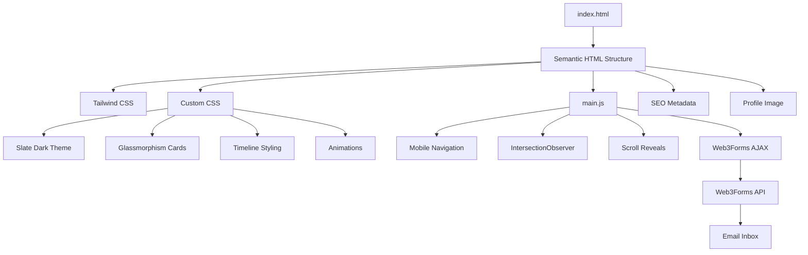

<div align="center">

# 💻 Professional Slate Dark Developer Portfolio

### *A Responsive, Interactive & Professional Developer Portfolio*

[](https://developer.mozilla.org/en-US/docs/Web/HTML)
[](https://tailwindcss.com/)
[](https://developer.mozilla.org/en-US/docs/Web/JavaScript)
[](https://developer.mozilla.org/en-US/docs/Web/CSS)
[](https://web3forms.com/)

</div>

---

## 📌 Table of Contents

- [Executive Summary](#-executive-summary)
- [Key Features](#-key-features)
- [Design System](#-design-system)
- [Interactive Experience](#-interactive-experience)
- [Contact Form & Email Integration](#-contact-form--email-integration)
- [Responsive Design](#-responsive-design)
- [Project Architecture](#-project-architecture)
- [Project Directory Structure](#-project-directory-structure)
- [Local Installation & Setup](#-local-installation--setup)
- [Customization](#-customization)
- [Deployment](#-deployment)
- [Author](#-author)
- [License](#-license)


---
### 🌐 **Live Interactive Web Application**
👉 **[https://portfilio-3hjl.onrender.com](https://portfilio-3hjl.onrender.com)** 👈


# 🚀 Executive Summary

This project is a **responsive, modern developer portfolio website** designed to present professional information, technical skills, projects, experience, achievements, and contact information through a polished user interface.

The portfolio uses a **Slate Dark visual system** with glassmorphism-inspired cards, Royal Blue accent elements, responsive layouts, interactive navigation, animated content reveals, and subtle hover interactions.

The website is built entirely on the frontend using:

- **Semantic HTML5** for accessible and structured page content.
- **Tailwind CSS** for responsive utility-based styling.
- **Custom CSS3** for the visual design system, glass effects, animations, timelines, and scrollbar customization.
- **Vanilla JavaScript** for navigation, animations, observers, and form submission.
- **Web3Forms API** for serverless contact-form email delivery.

The overall objective is to provide a professional online presence that allows recruiters, employers, collaborators, and visitors to quickly understand the developer's background and technical capabilities.

---

# 🎯 Key Features

| Feature | Description |
| :--- | :--- |
| **Slate Dark Theme** | Professional dark interface based around Slate-900 and Slate-800 tones. |
| **Responsive Layout** | Optimized for desktop, tablet, and mobile screen sizes. |
| **Mobile Navigation Drawer** | Hamburger navigation with an overlay drawer for smaller screens. |
| **Glassmorphism Cards** | Modern translucent card surfaces with borders and subtle visual effects. |
| **Interactive Timeline** | Professional timeline presentation for experience and achievements. |
| **Scroll Animations** | Sections progressively reveal themselves while entering the viewport. |
| **Hover Micro-Animations** | Interactive visual feedback on cards, skills, and timeline elements. |
| **Skills Showcase** | Dedicated presentation of technical and professional skills. |
| **Project Showcase** | Structured project presentation for highlighting development work. |
| **Achievements Section** | Dedicated area for professional and academic accomplishments. |
| **Contact Form** | Visitors can send messages directly through the portfolio. |
| **Web3Forms Integration** | Serverless email forwarding without requiring a custom backend. |
| **SEO Metadata** | Structured HTML metadata for better search-engine discoverability. |

---

# 🎨 Design System

The portfolio follows a **Professional Slate Dark** design language.

### Core Visual Direction

```text
Primary Background
        │
        ▼
   Slate Dark
        │
        ├── Slate-900
        ├── Slate-800
        └── Dark Neutral Surfaces
                 │
                 ▼
          Glassmorphism Cards
                 │
                 ▼
        Royal Blue Accents
```

### Design Principles

**1. High readability**

Dark backgrounds are combined with high-contrast typography to maintain comfortable reading across the portfolio.

**2. Visual hierarchy**

Important information such as the developer's name, professional role, projects, and skills receives stronger visual emphasis.

**3. Controlled animation**

Animations are intentionally subtle rather than excessive. Their purpose is to improve interaction feedback and guide the user's attention.

**4. Consistent components**

Cards, buttons, timelines, navigation elements, and section headings follow a consistent visual language throughout the website.

---

# 🧩 Interactive Experience

The portfolio combines CSS interactions with JavaScript-driven behavior.

## 1. Responsive Navigation

The navigation system provides a desktop navigation layout and a mobile hamburger menu.

On smaller screens:

```text
User
 │
 ▼
Hamburger Button
 │
 ▼
Navigation Drawer
 │
 ▼
Screen Overlay
 │
 ▼
Selected Section
```

The drawer allows visitors to navigate between portfolio sections without leaving the current page.

---

## 2. Dynamic Scroll Reveals

The website uses the JavaScript `IntersectionObserver` API to detect when content enters the viewport.

Conceptually:

```text
Page Load
   │
   ▼
Observe Elements
   │
   ▼
Element Enters Viewport?
   │
  Yes
   │
   ▼
Apply Reveal Class
   │
   ▼
Fade / Transform Animation
```

This provides a smoother browsing experience while avoiding unnecessary animations before content becomes visible.

---

## 3. Hover Micro-Interactions

Interactive elements respond to user interaction through subtle CSS transitions.

Examples include:

- Skill-card highlighting
- Timeline-item emphasis
- Border transitions
- Background glow effects
- Card elevation
- Button transitions

These interactions provide immediate visual feedback while maintaining a professional appearance.

---

# 📬 Contact Form & Email Integration

The portfolio includes a contact form powered by **Web3Forms**.

The integration allows visitors to submit:

- Name
- Email address
- Message

without requiring a custom backend server.

### Submission Architecture

```text
Visitor
   │
   ▼
Portfolio Contact Form
   │
   ▼
JavaScript Form Handler
   │
   ▼
Web3Forms API
   │
   ▼
Configured Email Inbox
```

This keeps the application lightweight while still providing functional contact communication.

---

# 🔐 Web3Forms Configuration

To enable email delivery, configure a Web3Forms access key.

### Step 1 — Generate an Access Key

Visit:

https://web3forms.com/

Create an access key using the email address where you want to receive portfolio messages.

### Step 2 — Open `index.html`

Locate the Web3Forms access-key field in the contact form.

```html
<input
    type="hidden"
    name="access_key"
    value="YOUR_KEY_HERE"
>
```

### Step 3 — Replace the Placeholder

Replace:

```text
YOUR_KEY_HERE
```

with your actual Web3Forms access key.

### Step 4 — Save and Test

Submit the contact form from the portfolio and verify that the message reaches the configured inbox.

> **Security note:** Never publish private API credentials or other sensitive secrets unnecessarily. If your Web3Forms configuration uses a client-side access key by design, follow Web3Forms' current security recommendations.

---

# 📱 Responsive Design

The website is designed around a responsive-first approach.

### Desktop

```text
┌───────────────────────────────────────────────┐
│ Logo / Name          Navigation               │
├───────────────────────────────────────────────┤
│                                               │
│              Hero / Introduction              │
│                                               │
├───────────────────────────────────────────────┤
│ Skills      Projects      Experience           │
├───────────────────────────────────────────────┤
│ Achievements              Contact              │
└───────────────────────────────────────────────┘
```

### Mobile

```text
┌───────────────────────┐
│ Logo             ☰    │
├───────────────────────┤
│                       │
│       Hero            │
│                       │
├───────────────────────┤
│ Skills                │
├───────────────────────┤
│ Projects              │
├───────────────────────┤
│ Experience            │
├───────────────────────┤
│ Achievements          │
├───────────────────────┤
│ Contact               │
└───────────────────────┘
```

Responsive behavior is implemented through Tailwind CSS utilities and custom CSS media queries where required.

---

# 🏗️ Project Architecture

The application follows a simple frontend architecture separating structure, styling, behavior, and static assets.



---

# 📂 Project Directory Structure

```text
PORTFOLIO/
│
├── index.html
│   # Main portfolio page
│   # Semantic structure, sections and SEO metadata
│
├── PROJECT_REPORT.md
│   # Comprehensive project audit and analysis
│
├── README.md
│   # Project documentation
│
├── assets/
│   │
│   ├── css/
│   │   └── style.css
│   │       # Custom Slate Dark theme
│   │       # Glass cards
│   │       # Timelines
│   │       # Animations
│   │       # Scrollbar styling
│   │
│   ├── js/
│   │   └── main.js
│   │       # Mobile navigation
│   │       # IntersectionObserver
│   │       # Scroll animations
│   │       # Web3Forms submission
│   │
│   └── images/
│       └── pv.png
│           # Profile picture
```

---

# ⚙️ Technology Stack

## Frontend

### HTML5

Used to create the semantic document structure and portfolio sections.

### Tailwind CSS

Used for:

- Responsive layouts
- Utility classes
- Spacing
- Typography
- Flexbox
- Grid layouts
- Responsive breakpoints

### CSS3

Custom CSS provides:

- Theme variables
- Glassmorphism effects
- Timeline styling
- Hover states
- Transitions
- Scrollbar customization
- Additional responsive behavior

### JavaScript

Vanilla JavaScript handles:

- Mobile navigation
- Hamburger menu behavior
- Navigation drawer interaction
- IntersectionObserver
- Scroll reveal animations
- Web3Forms AJAX submission

### Web3Forms

Provides serverless contact-form processing and email forwarding.

---

# 💻 Local Installation & Setup

## 1. Clone the Repository

```bash
git clone <YOUR_REPOSITORY_URL>
```

Navigate into the project:

```bash
cd PORTFOLIO
```

---

## 2. Open the Project

Because this is a frontend portfolio, no backend server is required for the basic website.

You can open:

```text
index.html
```

directly in a browser.

For development, using **Visual Studio Code with Live Server** is recommended.

---

## 3. Run with Live Server

Open the project in Visual Studio Code.

Install the **Live Server** extension if required.

Then:

```text
Right Click → index.html → Open with Live Server
```

The website will open in your browser.

---

# 🛠️ Customization

The portfolio can be customized by modifying the following files.

### `index.html`

Use this file to change:

- Personal information
- About section
- Skills
- Projects
- Experience
- Achievements
- Social links
- Contact information
- SEO metadata

### `assets/css/style.css`

Use this file to modify:

- Colors
- Backgrounds
- Card appearance
- Borders
- Shadows
- Animations
- Timeline design
- Scrollbar
- Responsive styling

### `assets/js/main.js`

Use this file to modify:

- Navigation behavior
- Mobile drawer
- Scroll animations
- IntersectionObserver configuration
- Contact-form submission behavior

### `assets/images/pv.png`

Replace this image with another profile image while preserving the referenced filename, or update the image path inside `index.html`.

---

# 🌐 Deployment

Because the portfolio is primarily a static frontend application, it can be deployed using a static hosting platform.

Typical deployment workflow:

```text
Git Repository
      │
      ▼
Static Hosting Platform
      │
      ▼
Build / Deploy
      │
      ▼
Public Portfolio URL
```

Before deployment, verify:

- All asset paths work correctly.
- Navigation links work.
- Mobile navigation works.
- Images load correctly.
- Contact form is configured.
- Web3Forms submissions work.
- External links point to the intended profiles.
- SEO metadata contains the correct personal information.

---

# 🧪 Recommended Testing Checklist

Before publishing the portfolio, test the following:

### Navigation

- [ ] Desktop navigation
- [ ] Mobile hamburger button
- [ ] Navigation drawer
- [ ] Overlay behavior
- [ ] Section anchor links

### Responsive Design

- [ ] Desktop
- [ ] Laptop
- [ ] Tablet
- [ ] Mobile
- [ ] Different browser widths

### Interactions

- [ ] Scroll animations
- [ ] Hover effects
- [ ] Timeline interactions
- [ ] Buttons
- [ ] Navigation transitions

### Contact Form

- [ ] Name field
- [ ] Email field
- [ ] Message field
- [ ] Form validation
- [ ] Web3Forms access key
- [ ] Email delivery

### Performance

- [ ] Image optimization
- [ ] CSS loading
- [ ] JavaScript loading
- [ ] Broken links
- [ ] Browser console errors

---

# 👨‍💻 Author

**Venkata Sai Ravish Punati**

AI & Machine Learning background with interests in:

- Artificial Intelligence
- Machine Learning
- Data Analytics
- Web Development
- Business & Technology
- Research and Emerging Technologies

### Portfolio

https://portfilio-3hjl.onrender.com

### GitHub

https://github.com/pvsairavish

### LinkedIn

https://www.linkedin.com/in/ravish-punati-319a84253/

---

# 📄 License

This project is intended as a personal developer portfolio.

The source code may be adapted for personal learning and portfolio development. If substantial portions are reused publicly, appropriate attribution is recommended.

---

# ⚠️ Disclaimer

The information presented on this portfolio is intended for professional and informational purposes.

External services such as Web3Forms are subject to their respective terms, availability, and service policies.

---

<div align="center">

### ⭐ If you find this portfolio useful, consider giving the project a star.

**Built with HTML5 · Tailwind CSS · CSS3 · JavaScript · Web3Forms**

</div>
